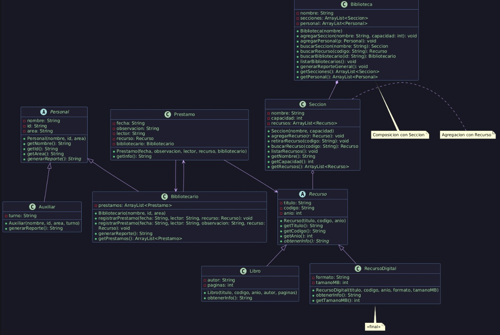

# Sistema de Gestión de Biblioteca Universitaria

Proyecto final del curso **Programación Orientada a Objetos** — Universidad EAN.

Aplicación de consola en Java para administrar la *Biblioteca Central Los Libertadores*: sus secciones, los recursos (libros físicos y recursos digitales), el personal (bibliotecarios y auxiliares) y el control de préstamos. Funciona con un menú interactivo y maneja con excepciones los errores que pueden ocurrir en tiempo de ejecución.

---

## Integrantes

| Nombre |
|---|
| Cristian David Albarracín Isaza |
| Andrés Felipe Copete Villamarín |
| José Alejandro Vargas Rojas |

---

## Diagrama de clases

 


---

## Estructura del proyecto

```
Proyecto-Final/
├── .gitignore
├── README.md
└── src/
    └── com/biblioteca/
        ├── app/
        │   └── App.java                         
        ├── modelo/
        │   ├── Personal.java                     
        │   ├── Bibliotecario.java
        │   ├── Auxiliar.java
        │   ├── Recurso.java                      
        │   ├── Libro.java
        │   ├── RecursoDigital.java               
        │   ├── Prestamo.java
        │   ├── Seccion.java
        │   ├── Biblioteca.java
        │   └── Validador.java                   
        └── excepciones/
            ├── SeccionLlenaException.java
            ├── RecursoNoEncontradoException.java
            ├── PersonalNoEncontradoException.java
            └── PrestamoInvalidoException.java
```

---

## Cómo compilar y ejecutar

Requisitos: **JDK 8 o superior**.

Desde la raíz del repositorio:

```bash
# Compilar (UTF-8 para que las tildes se vean bien)
javac -encoding UTF-8 -d bin src/com/biblioteca/excepciones/*.java src/com/biblioteca/modelo/*.java src/com/biblioteca/app/*.java

# Ejecutar
java -cp bin com.biblioteca.app.App
```

También se puede abrir la carpeta en VS Code / NetBeans / IntelliJ y ejecutar `App.java`.

---

## Menú de la aplicación

| Opción | Acción |
|---|---|
| 1 | Registrar recurso (1 = Libro, 2 = Recurso digital) |
| 2 | Listar recursos registrados |
| 3 | Ubicar un recurso registrado en una sección |
| 4 | Registrar préstamo |
| 5 | Ver recursos de una sección |
| 6 | Ver préstamos de un bibliotecario |
| 7 | Dar de baja un recurso de una sección |
| 8 | Buscar recurso por código |
| 9 | Reporte general de la biblioteca |
| 10 | Crear nueva sección en tiempo de ejecución |
| 0 | Salir |

Datos iniciales cargados al iniciar:

- **Secciones:** Referencia (10), Literatura (8), Ciencias (6).
- **Bibliotecarios:** Marta Rojas (`B001`, Circulación), Julián Pardo (`B002`, Referencia).
- **Auxiliar:** Diana Cruz (`A001`, Catalogación, turno Tarde).

---

## Conceptos de POO aplicados

| Concepto | Dónde se aplica |
|---|---|
| **Encapsulamiento** | Todos los atributos son `private`; las subclases acceden por los getters heredados. `Validador` tiene constructor `private`. |
| **Herencia y clases abstractas** | `Personal` (abstracta) → `Bibliotecario`, `Auxiliar`. `Recurso` (abstracta) → `Libro`, `RecursoDigital`. |
| **Clase `final`** | `RecursoDigital` no puede heredarse. |
| **Polimorfismo estático (sobrecarga)** | `Bibliotecario.registrarPrestamo(fecha, lector, recurso)` y `registrarPrestamo(fecha, lector, observacion, recurso)`. |
| **Polimorfismo dinámico (sobreescritura)** | `generarReporte()` en `Bibliotecario` y `Auxiliar`; `obtenerInfo()` en `Libro` y `RecursoDigital`. `Seccion.listarRecursos()` y `Biblioteca.generarReporteGeneral()` los invocan sin conocer el subtipo. |
| **Composición** | `Biblioteca` → `Seccion`: la biblioteca crea sus secciones en el constructor y en `agregarSeccion()`; si la biblioteca desaparece, sus secciones también. |
| **Agregación** | `Seccion` → `Recurso` (`ArrayList<Recurso>`): los recursos existen independientemente de la sección y una sección acepta libros y recursos digitales. |
| **Asociación** | `Prestamo` relaciona un `Bibliotecario` con un `Recurso` real (nunca `null`). |

---

## Manejo de excepciones

### Excepciones personalizadas (`com.biblioteca.excepciones`)

| Excepción | Se lanza cuando |
|---|---|
| `SeccionLlenaException` | Se intenta ubicar un recurso en una sección que alcanzó su capacidad. |
| `RecursoNoEncontradoException` | No existe un recurso con el código dado (buscar, dar de baja, préstamo). |
| `PersonalNoEncontradoException` | El id no corresponde a ningún bibliotecario registrado. |
| `PrestamoInvalidoException` | Fecha, lector u observación vacíos, o recurso `null`. |

### Validaciones adicionales

- **`Validador.validarNombre`**: el nombre del personal no puede estar vacío ni contener dígitos.
- **`Validador.validarCodigo`**: el código del recurso no puede estar vacío ni tener espacios.
- **Constructores**: título no vacío, año entre 1450 y 2026, páginas > 0, tamaño en MB > 0, capacidad de sección > 0 (`IllegalArgumentException`, capturada en `App`).
- **`leerEntero(sc, mensaje)`**: todas las lecturas numéricas insisten hasta recibir un entero válido, capturando `InputMismatchException` y limpiando el buffer.
- Opciones fuera del menú, tipo de recurso distinto de 1 o 2 y respuestas distintas de `s`/`n` se rechazan con un mensaje.

---

## Decisiones de diseño

- **Búsqueda de recursos y préstamos:** `Biblioteca.buscarRecurso()` solo encuentra recursos que ya están **ubicados en una sección**. El equipo decidió **exigir que el recurso se ubique primero (opción 3)** antes de poder prestarlo (opción 4) o buscarlo por código (opción 8). Un recurso recién registrado queda en la lista temporal `recursosRegistrados` (visible en la opción 2) hasta que se ubica.
- **Lista temporal `recursosRegistrados`:** vive en `App` y guarda todos los recursos creados, estén o no en una sección. La opción 3 toma el recurso de esta lista para ubicarlo.
- **Dar de baja:** retirar un recurso de una sección no lo elimina de `recursosRegistrados`, por lo que puede volver a ubicarse.
- **`listarBibliotecarios()`** recorre el personal real de la biblioteca (sin datos quemados) y filtra con `instanceof Bibliotecario`.

